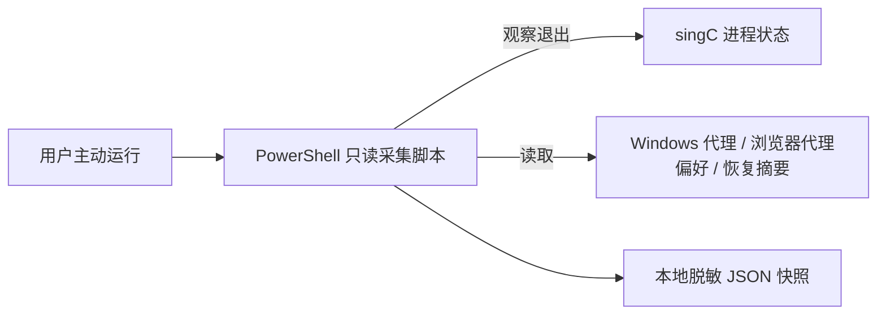

# singC 系统级模块架构

以下为当前源码的主要模块和进程边界，不是拟议重构方案。实线表示调用、控制或读写，虚线表示事件、快照或状态回传；为保持可读性，省略通用设置读取和 UI 属性通知等重复连线。

```mermaid
flowchart TB
    subgraph Desktop["singC.exe · WinUI 桌面主进程"]
        Shell["App / MainWindow<br/>启动、导航、退出协调"]
        subgraph UI["页面模块"]
            Home["HomePage / LogPage<br/>启动停止、模式切换、日志"]
            Monitor["ConnectionsPage / TrafficStatisticsPage<br/>连接列表与流量展示"]
            Settings["SettingsPage<br/>配置、规则、偏好与更新入口"]
            TestPage["NetworkTestPage<br/>诊断、稳定性测试与历史展示"]
        end
        subgraph Runtime["内核运行与配置"]
            CoreService["SingBoxService<br/>进程生命周期、配置校验、日志"]
            Mode["ProxyModeConfig<br/>生成 TUN / 代理运行配置"]
            Editor["SettingsViewModel / RouteConfigDocument<br/>规则编辑、配置保存与备份"]
            Proxy["SystemProxyLease / WindowsSystemProxy<br/>系统代理强制回退、TUN 条件恢复"]
            ProxyLog["ProxyDiagnosticLog<br/>恢复阶段、字段差异及错误日志"]
            CheckRunner["ConfigCheckRunner<br/>校验进程、截止时间、有界输出"]
            ConfigStore["ConfigFileStore / ConfigLoadCoordinator<br/>原子配置写入、备份清理、过期读取保护"]
        end
        subgraph Observability["连接与统计"]
            Connections["ConnectionViewModel<br/>采集会话、列表刷新与筛选"]
            WS["ClashWebSocketService<br/>连接快照、累计字节与重连"]
            Traffic["TrafficStatisticsViewModel<br/>TrafficStatistics / OutboundTrafficStatistics<br/>总量与出站采样统计、持久化"]
            Snapshot["ClashApiEndpoint / ClashConnectionSnapshot<br/>运行端点、整帧校验、连接去重"]
            StatisticsStore["StatisticsFileStore<br/>独占写者、原子保存、损坏保护"]
            Bandwagon["BandwagonTrafficService<br/>本机查询套餐流量、超时与限流"]
            QuotaCoordinator["BandwagonQueryCoordinator<br/>8 小时流量刷新、仅手动配额查询<br/>独立缓存、冷却与请求串行"]
            Credentials["BandwagonSettings / WindowsSecretProtection<br/>VEID 与密钥原子保存、当前用户加密"]
        end
        Presentation["ConnectionPresentation / LogAnalysis<br/>纯筛选排序、日志分析"]
        SettingsStore["SettingsStore<br/>串行读改写、失败回滚、损坏提示"]
        Shutdown["ShutdownSequence<br/>停止、保存、清理顺序"]
        Handoff["BoundedResponse / UpdateHandoff<br/>有界元数据、可控交接等待"]
        Diagnostic["NetworkTestService<br/>HTTP / DNS / TCP / 控制接口 / 出口 IP"]
        Shared["AppSettings / BackgroundManager<br/>StartupManager / NativeFileDialog<br/>偏好、外观与平台辅助"]
        Update["AppUpdateService<br/>检查版本、下载、校验与更新协调"]
    end

    subgraph Kernel["sing-box.exe · 独立内核进程"]
        Engine["代理 / TUN 入站、路由与出站"]
        API["Clash API<br/>WebSocket /connections · HTTP /version"]
    end
    subgraph Installer["singC.Updater.exe · 独立更新进程"]
        Updater["Updater/Program + UpdateCore<br/>等待退出、安装事务、失败回滚、重启"]
    end
    OS["Windows<br/>系统代理、网络栈、权限与自启动"]
    Files[("本地文件<br/>用户配置与备份 / 临时运行配置<br/>settings.json / 流量统计 JSON<br/>代理恢复记录 / 更新暂存与备份")]
    Internet["目标网站 / DNS / 出口查询服务<br/>及内核配置的远端出站"]
    GitHub["GitHub Releases<br/>版本信息、发布包与校验文件"]
    Quota["搬瓦工 KiwiVM API<br/>getServiceInfo / getRateLimitStatus"]

    Shell --> Home
    Shell --> Monitor
    Shell --> Settings
    Shell --> TestPage
    Shell --> Shared
    Shell -->|初始化与退出协调| Connections
    Shell -->|退出停止| CoreService
    Shell --> Shutdown
    Shutdown -->|停止、保存与清理委托| CoreService
    Shutdown --> Connections
    Shell -->|自动检查| Update
    Home --> CoreService
    CoreService -.->|状态与日志| Home
    Home --> Traffic
    Monitor --> Connections
    Monitor --> Traffic
    Settings --> Editor
    Settings --> Shared
    Settings --> Update
    Editor -->|内核校验| CoreService
    Editor --> ConfigStore
    ConfigStore -->|配置与备份| Files
    CoreService --> Mode
    CoreService --> Proxy
    CoreService --> CheckRunner
    CheckRunner -->|check、输出与取消| Engine
    CoreService -->|启动 / 停止 / check| Engine
    CoreService -->|读取源配置、写运行配置| Files
    Engine -.->|标准输出、错误与退出| CoreService
    Proxy --> OS
    Proxy --> ProxyLog
    ProxyLog -->|脱敏 JSONL 与轮转| Files
    Proxy -->|恢复记录| Files
    Shared --> Files
    Shared --> SettingsStore
    SettingsStore --> Files
    Shared --> OS
    CoreService -.->|运行状态事件| Connections
    Connections -->|启动 / 停止采集| WS
    Connections -->|实际运行配置的端点与代次| CoreService
    WS --> Snapshot
    Connections --> Presentation
    Home --> Presentation
    WS -->|订阅 /connections| API
    WS -.->|连接快照| Connections
    WS -.->|总量与连接计数快照| Traffic
    Connections -->|统计会话与保存协调| Traffic
    Traffic --> StatisticsStore
    StatisticsStore --> Files
    TestPage --> Diagnostic
    TestPage -->|参数与历史保存| Shared
    TestPage -->|读取运行状态| CoreService
    Diagnostic -->|读取控制接口配置| Files
    Diagnostic -->|HTTP /version| API
    Diagnostic -->|HTTP / DNS / TCP 探测| Internet
    Engine --> OS
    Engine --> Internet
    Update --> GitHub
    Update --> Handoff
    Update -->|退出前保存与释放采集| Connections
    Update -->|校验与暂存更新包| Files
    Update -->|停止内核后交接| CoreService
    Update -->|启动更新助手、退出主程序| Updater
    Updater -->|替换 / 备份 / 回滚| Files
    Updater -->|重启并等待就绪标记| Shell
    Shell -->|启动 / 保存 / 每 8 小时流量刷新| QuotaCoordinator
    Shell -->|仅手动查询 API 点数| QuotaCoordinator
    QuotaCoordinator --> Bandwagon
    Shell -->|读取凭据| Credentials
    Settings -->|保存 / 清空凭据| Credentials
    Credentials --> SettingsStore
    Credentials -->|Windows DPAPI| OS
    Bandwagon -->|HTTPS POST 凭据，不跟随重定向| Quota

    classDef focus fill:#fff3cd,stroke:#986b00,stroke-width:2px,color:#202020;
    class Diagnostic focus;
```

架构阅读要点：

- 黄色节点标识网络诊断模块。网络诊断直接执行平台网络请求，HTTP 会受当前系统代理、TUN 和路由影响，不能将成功结果等同于“已走代理”；它不负责控制内核。
- 连接页与统计页共享采集链路。WebSocket 原始计数快照直接交给统计模块，连接列表的搜索、排序和刷新不作为统计输入。
- 采集端点和密钥来自内核当前运行配置；整帧最多 16 MiB，解析与去重后才分发。回调核对订阅代次及内核运行代次，停止时中止连接并限制等待。
- 两种统计算法保持独立，共用 `StatisticsFileStore`：以文件租约保证单一写者，第二实例只能读取磁盘历史；损坏文件禁止覆盖。设置通过 `SettingsStore` 串行提交，失败时不发布内存变更。
- 配置保存绑定操作开始时的路径和文本；页面使用忙碌状态及加载代次防止交错覆盖。窗口关闭会等待停止、统计保存与资源释放；失败保留窗口并提示。
- 更新元数据与校验文件分别限制为 1 MiB、1 KiB；交接等待提取为纯委托接缝。更新事务协议与包格式不变，尚未增加崩溃后自动恢复协议。
- 套餐查询由 `BandwagonQueryCoordinator` 协调：流量在启动、保存后及每 8 小时刷新；API 点数仅由侧栏按钮手动查询，不随流量刷新访问。按凭据对分开维护内存缓存、独立手动冷却及已知余量耗尽保护；HTTP 限流暂停两个端点。异常保留上次数据及原时间，不把点数换算为精确调用次数或推测官方重置时刻。凭据按当前 Windows 用户加密后成对原子写入设置；空配置不请求。单个请求最多 30 秒、响应最多 1 MiB，保存配置后丢弃旧请求结果。HTTP 仍受本机系统代理、TUN 和路由影响，“本地查询”不表示强制直连。该数据与内核流量采样独立。
- 内核执行实际代理、TUN 和路由；singC 管理进程与配置。更新助手是独立进程，`UpdateCore` 是更新逻辑代码库，并非额外运行服务。图中的本地文件是存储边界，不是数据库服务。
- 页面同时使用代码后置、服务和部分 ViewModel；图中分组表达职责，不声称当前系统已经采用严格分层或完整 MVVM。

源码核对入口：`App.xaml.cs`、`MainWindow.xaml.cs`、`Pages/*.xaml.cs`、`Models/SingBoxService.cs`、`Models/ConnectionViewModel.cs`、`Models/ClashWebSocketService.cs`、`Models/TrafficStatisticsViewModel.cs`、`Models/SettingsViewModel.cs`、`Models/AppUpdateService.cs`、`Helper/AppSettings.cs`、`Helper/SystemProxyLease.cs`、`Updater/Program.cs` 和 `UpdateCore/*`。本图通过静态调用关系核对，不代表已执行系统级运行测试。

## 代理恢复诊断

系统代理租约停止、切换、退出或下次启动补恢复时，无条件写回该次启用前的完整快照，覆盖期间的外部修改；当前设置回读仅用于诊断，读取失败不阻止写回。写回抛错保留恢复记录供重试。原设置若已启用代理，恢复后也会启用。TUN-only 租约继续采用原有匹配恢复策略；这里没有新增监护或自启动。

`LoggingSettings` 提供共用的日志输出开关，由设置页“日志开关”控制，默认关闭，通过 `SettingsStore` 持久保存。启用后 `ProxyDiagnosticLog` 记录窗口退出、内核停止、代理写入/恢复及字段比较结果，输出至本地 `proxy-diagnostics.jsonl` 并轮转。设置值仅保留标志和内容指纹，日志失败不改变恢复控制流程。代理恢复备份不受开关影响；内核运行输出和用户主动执行的外部采集脚本不属于此诊断文件开关。详见 [代理恢复日志](PROXY-RECOVERY-LOG.md)。

## 用户主动运行的外部采集工具

`Scripts/Collect-ProxyDiagnostics.ps1` 是独立的只读诊断脚本，由用户主动运行，观察 singC 退出并记录前后系统代理、浏览器代理偏好与恢复记录摘要。它不参与代理设置或恢复，不注册自启动，也不改变主程序生命周期。采集到的磁盘配置不代表浏览器请求实际采用的路径。操作说明见 [代理故障现场采集](PROXY-DIAGNOSTICS.md)。

## 维护约定

- 本文件是系统级模块架构的统一维护入口；质量报告等文档通过链接引用，避免维护多份副本。
- 模块职责、进程边界、主要调用关系或持久化方式发生变化时，同步更新图、说明及源码核对入口。
- 图示反映已实现的代码；拟议设计应另行标注，不混入当前架构。
- 最近源码核对日期：2026-10-09；包含网络诊断改进及本轮四批质量改进。平台交互仍需单独系统级验证。
